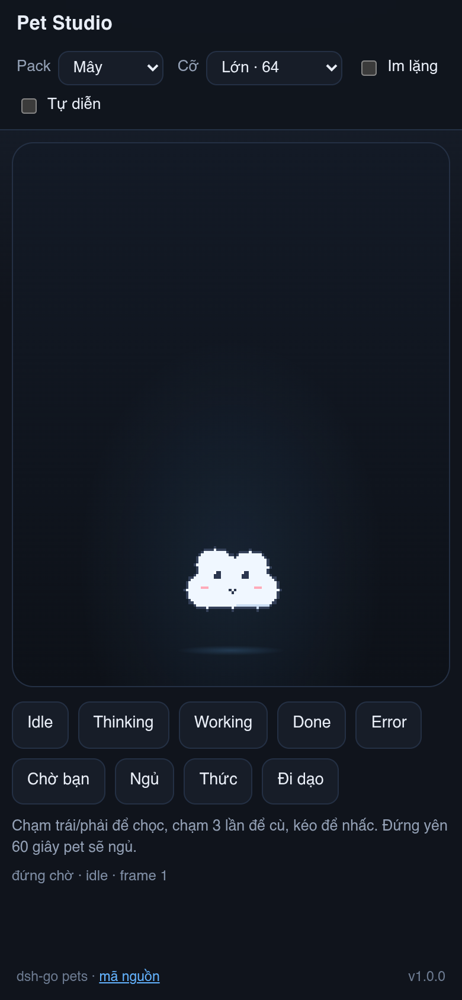
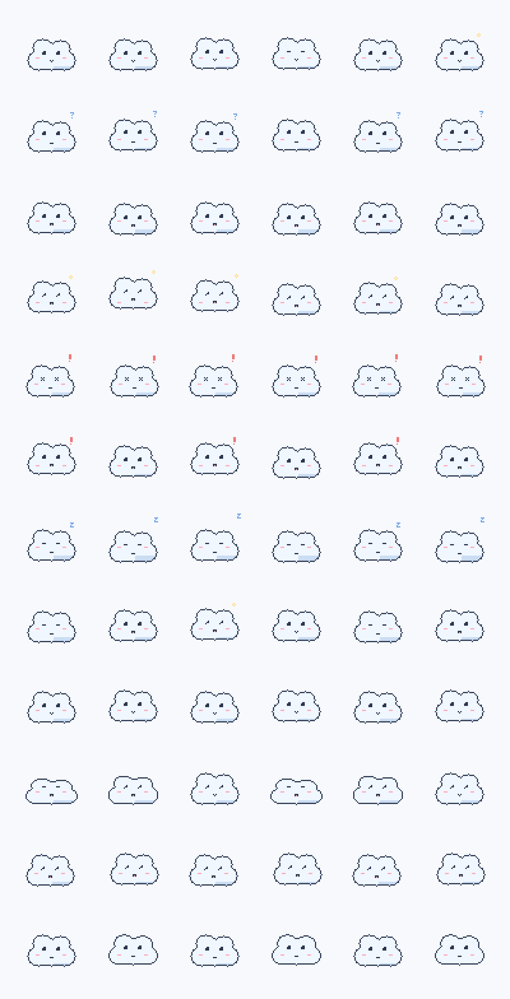

# dsh-go · Pets (bản trích xuất)

Mã nguồn chức năng **Pets** — thú cưng trạng thái — của [dsh-go](https://github.com/ccch1mneyyy/dsh-Go), tách ra để đọc, học và tái sử dụng.

| | |
|---|---|
| Nguồn | [ccch1mneyyy/dsh-Go](https://github.com/ccch1mneyyy/dsh-Go) |
| Commit | `5fc5f41a20a33cb95fcd8ac119d67a32a7559dfa` (2026-11-22) |
| Giấy phép | AGPL-3.0 — xem [LICENSE](LICENSE) |
| Quy mô | 141 tệp mã nguồn từ upstream + 2 pet tự làm + web app, ~4 MB |

> Đây **không phải** một package độc lập. Tệp giữ nguyên đường dẫn gốc (`app/lib/...`, `app/android/...`) để dễ đối chiếu với upstream, nhưng thiếu phần còn lại của app nên không thể `flutter build` một mình. Danh sách đầy đủ và cách trích xuất ở [EXTRACT.md](EXTRACT.md).

## Ứng dụng Android (APK)



**[Tải PetStudio.apk](https://github.com/vukiengiang2025-sys/dsh-go-pets/releases/download/android-latest/PetStudio.apk)** — Android 7.0+, chạy offline, không xin quyền nào.

- Mở APK để cài (máy có thể hỏi "Cài từ nguồn không xác định" — bật cho trình quản lý tệp).
- 2 pet (**Mây**, **DSH Bot**) + **nhập pet riêng từ ảnh/GIF/APNG/WebP/zip** ngay trong app, 9 trạng thái, chuyển cảnh mượt, hạt cảm xúc, vuốt ve, ném pet, chạm đúp mở cài đặt, đọc thành tiếng khi có việc, nhắc đứng dậy mỗi N phút, chat ngắn + sổ nhớ + kể chuyện + tóm tắt, bong bóng "Chờ bạn" có nút **Đã xử lý**, nhớ pack/cỡ/im lặng, onboarding, chuỗi ngày, nhiệm vụ đi dạo, Pomodoro 25/5, chia sẻ cấu hình bằng link, xuất ảnh/GIF, kết nối agent qua endpoint HTTP (tuỳ chọn), widget màn hình chính hiện pet + trạng thái, nhấn giữ icon có shortcut mở thẳng từng pet.
- APK được GitHub Actions build lại mỗi khi `android/`, `pet-studio/` hoặc pet pack thay đổi; xem [android/README.md](android/README.md).
- Bản phát hành ký bằng khoá cố định trong repo (cài đè được, không phải gỡ app); phát hành store thì thay keystore.
- Điểm chất lượng tự chấm: **1000/1000** — chi tiết và bằng chứng ở [QUALITY.md](QUALITY.md).

## Pets làm gì

Pet là **bộ chỉ báo trạng thái**, không phải game nuôi: nó chỉ kể agent đang làm gì và có gì đang chờ bạn. Một vòng chạy xong, gặp lỗi, hoặc đang chờ bạn xác nhận/trả lời thì pet diễn hoạt ảnh và bắn bong bóng. Pet đứng trên ô nhập trong app; bật **hiển thị ngoài app** thì thành cửa sổ nổi trên Android (kéo, bám cạnh, nửa bánh xe tiện ích, hỏi nhanh, chụp màn hình hỏi).

Trạng thái (đặt tên theo Clawd on Desk): `idle`, `thinking`, `working`, `juggling`, `sweeping`, `notification`, `attention`, `error`, `carrying`, `sleeping`, `waking`.

Pet pack = một zip + `pack.json` + các ảnh PNG dạng lưới khung hình. Định dạng, giới hạn và cách tự làm pack: [docs/pets/README.md](docs/pets/README.md); đặc tả đầy đủ: [docs/design/pets.md](docs/design/pets.md).

## Trong repo có gì

| Thành phần | Đường dẫn | Tệp |
|---|---|---|
| Lõi Flutter: mood reducer, signals, pack parser/validator, thư viện pet, overlay channel, hành động | `app/lib/pets/` | 20 |
| Giao diện trong app: sân khấu, bong bóng, bộ chọn, cài đặt, menu, sprite | `app/lib/ui/pets/` | 9 |
| Nối vào plugin seam + PiP iOS | `app/lib/plugins/seams/adapters/pet_adapter.dart`, `app/lib/ui/phone/ios_pet_pip_section.dart` | 2 |
| Chuỗi dịch | `app/lib/l10n/parts/pet_actions_{en,zh}.arb` | 2 |
| Cầu nối MethodChannel + probe dev | `app/lib/pets/overlay_channel.dart`, `app/lib/dev/pet_*` | 4 |
| Overlay Android (Kotlin): service, cửa sổ nổi, bánh xe, thanh hỏi, chụp màn hình, bám cạnh | `app/android/app/src/main/kotlin/.../pet/` | 22 |
| Test Kotlin của overlay | `app/android/app/src/test/kotlin/.../pet/` | 17 |
| Icon Android | `app/android/app/src/main/res/drawable/ic_pet_*` | 2 |
| Overlay iOS (Swift, Picture-in-Picture) | `app/ios/Runner/PetOverlay/` | 5 |
| Test Dart (pack, golden, overlay, actions, stage…) | `app/test/pets/`, `app/test/*/…pet…` | 32 |
| Công cụ: sinh pack, đổi theme, rules JSON, probe | `app/tool/` | 10 |
| Manifest pet pack mẫu | `app/assets/pets/*/pack.json` | 3 |
| Tài liệu thiết kế, hướng dẫn, kiểm thử | `docs/` | 9 |
| **Pet mẫu "Mây"** (nhân vật tự vẽ, CC BY 4.0) | `app/assets/pets/may/`, `art/may/` | 13 + 18 |
| **Pet "DSH Bot"** (tách từ sheet của bạn, CC BY 4.0) | `app/assets/pets/dsh-bot/`, `art/dsh-bot/` | 11 + 20 |
| **Pet Studio** — web app chơi thử pack | `pet-studio/` | 7 |
| **App Android** — WebView + asset loader, icon, shortcut, widget | `android/` | 24 |
| **CI build APK** | `.github/workflows/android.yml` | 1 |

## Pet mẫu: Mây

Một nhân vật 64×64 vẽ bằng pixel, tự sinh bằng script (không dùng ảnh ngoài), đủ 11 trạng thái + 3 phản ứng:



- Nguồn: [`art/may/generate.py`](art/may/generate.py) — sửa `PALETTE` / `in_body()` / `ANIMS` là ra nhân vật của bạn.
- Pack đã đóng sẵn: [`app/assets/pets/may/`](app/assets/pets/may) — đã **PASS** kiểm tra nhập của app.
- Bản zip để nhập thử trên điện thoại: `/sdcard/Download/DSH-Go/may.zip` (nhập ở **Cài đặt → Pets → ô cuối bộ chọn**).
- Giấy phép hình: [CC BY 4.0](art/may/LICENSE-ART.md); hướng dẫn sửa và đóng gói: [art/may/README.md](art/may/README.md).

## Pet Studio: biến pets thành ứng dụng

`pet-studio/` là một web app tĩnh (không build, không thư viện) để dùng pet ngoài app:

```sh
cd dsh-go-pets && python3 -m http.server 8099
# mở http://127.0.0.1:8099/pet-studio/
```

- Đổi pack (Mây / DSH Bot), đổi cỡ 22–64 dp, bật "Im lặng" hoặc "Tự diễn".
- Đủ 9 trạng thái; chạm trái/phải để poke, chạm 3 lần để cù, kéo để nhấc, đứng yên 60 giây thì ngủ.
- `pet-engine.js` là bộ máy trạng thái thuần (không DOM) — test được bằng Node; `pet-studio.js` chỉ lo canvas.
- Chi tiết và cách thêm pack: [pet-studio/README.md](pet-studio/README.md).

```text
pet pack (pack.json + lưới PNG)
        │
   PetModel (pet-engine.js): chọn animation theo trạng thái, one-shot, reaction,
        │                     auto-sleep, giữ notification
   Renderer (pet-studio.js): cắt ô lưới, vẽ theo contentBox, DPR, pixel/smooth
```

## Luồng hoạt động

```text
sự kiện host / lượt chạy / chờ xác nhận / chạm
        │
   pet_signals.dart        (gom tín hiệu, không gọi model)
        │
   pet_mood.dart           (giảm về một trạng thái + mức ưu tiên)
        │
     PetState  ──► pet_stage.dart / pet_bubble.dart   (pet trong app)
        │
        └─ MethodChannel "dsh/pet_overlay" ─► PetOverlayPlugin.kt
                                              └─► PetOverlayService / PetView / PetMenuView
```

Phía pack: `pet_archive.dart` (giải zip an toàn) → `pet_pack_validator.dart` (giới hạn, chuẩn hoá NFC) → `pet_library.dart` (thư viện + import) → `pet_sheets.dart` / `pet_sprite.dart` (cắt lưới, vẽ pixel khớp physical pixel). Overlay đọc cùng một `pack.json` nhưng parse chặt hơn (số nguyên, hình học theo Float32 của Android).

Các cờ người dùng (`pet_prefs.dart`): bật/tắt, kích thước (nhỏ/chuẩn/lớn/tuỳ chỉnh), chế độ im lặng, vị trí, ẩn 1 giờ, hiển thị ngoài app.

## Điểm nối vào app (không nằm trong repo)

Muốn ghép lại vào một bản dsh-go, cần thêm ở phía app:

| Nơi | Việc |
|---|---|
| `app/pubspec.yaml` | khai báo `assets/pets/<id>/`; phụ thuộc: `archive`, `crypto`, `image`, `file_picker`, `path_provider`, `shared_preferences`, `flutter_riverpod`, package nội bộ `dsh_client` |
| `app/lib/ui/shell/home_shell.dart`, trang chat | gắn `PetStage` trên ô nhập, giữ chỗ đáy danh sách |
| `app/lib/state/*` (`chat_state`, `hosts_state`, `notify_state`, `session_attention_state`, `run_pulse`, `performance_state`, `connection_state`, `compose_inbox`, `sessions_state`) | nguồn tín hiệu mà `pet_signals.dart` đọc |
| `app/lib/l10n/` | gộp `parts/pet_actions_*.arb` vào bảng chuỗi |
| `MainActivity` / đăng ký plugin | đăng ký `PetOverlayPlugin` |
| `AndroidManifest.xml` | `PetOverlayService` (foreground service), quyền `SYSTEM_ALERT_WINDOW`, `FOREGROUND_SERVICE*` |
| `app/ios/Runner/DshPlugin.swift` | đăng ký kênh PiP của `PetOverlay/` |
| `app/lib/plugins/seams/` | `seat_models` / `slot_catalog` / `seat_planner` cho `pet_adapter.dart` |
| Chat page | lắng nghe `petSignalsProvider`, chuyển trạng thái xuống `PetStage` |

## Chạy thử

Chép thư mục vào một bản checkout dsh-go (đè lên đúng đường dẫn), rồi:

```sh
cd app
flutter test test/pets            # test pack, golden, overlay, stage
flutter test test/pets/overlay    # riêng phần overlay
cd ..
python3 -m pytest app/tool/test_make_pet_pack.py app/tool/test_pet_theme_convert.py
cd app/android && ./gradlew test --tests '*pet*'
```

Golden test cần ảnh chuẩn trong `test/pets/goldens/` — bản trích xuất này **không kèm** (xem mục dưới).

## Về phần hình ảnh

Bản trích xuất **cố ý không kèm** PNG/APNG/GIF của Deepy, cá hồng và whale-girl (thư mục `app/assets/pets/*/*.png`, `app/tool/pet_src/`, `docs/assets/pet-*.gif`, ảnh golden). Theo [ASSETS.md](ASSETS.md) của upstream, các tài nguyên hình ảnh đó **không** thuộc AGPL-3.0 mà giữ mọi quyền, và khi phát hành bản phái sinh nên thay bằng tên và tài nguyên của bạn.

Vì vậy phần mã nguồn chỉ đi kèm `pack.json` mẫu của upstream, **trừ** pet "Mây" ở trên — nhân vật đó do repo này tự vẽ và phát hành CC BY 4.0.

Muốn có thêm pet khác:

- tự vẽ một pack theo [docs/pets/README.md](docs/pets/README.md) (chỉ cần vài PNG) — xem mẫu [art/may](art/may/README.md), hoặc
- dùng `app/tool/pet_theme_convert.py` để đổi một theme Clawd on Desk / bộ GIF thành pet pack, hoặc
- tự lấy tài nguyên từ upstream khi bạn có quyền dùng chúng.

## Ghi công

- Mã nguồn gốc: **ccch1mneyyy** và những người đóng góp cho [dsh-go](https://github.com/ccch1mneyyy/dsh-Go), AGPL-3.0.
- Giao thức trạng thái và tên trạng thái theo [Clawd on Desk](https://github.com/rullerzhou-afk/clawd-on-desk).
- Bản trích xuất này chỉ sao chép nguyên văn, không sửa logic; nếu dùng lại, giữ nguyên AGPL-3.0 và ghi công upstream.

Repo này không liên kết chính thức với dsh-go hay DeepSeek.
