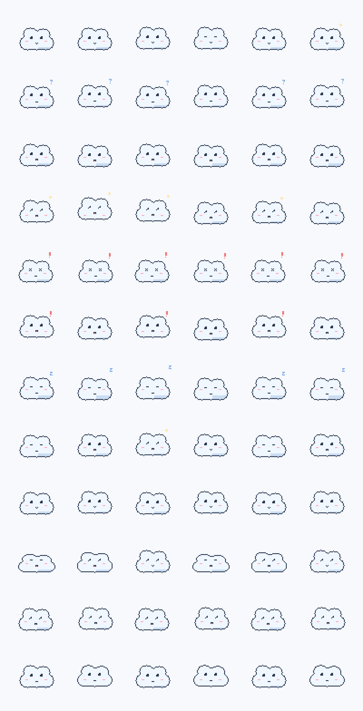

# Nhân vật mẫu: Mây

Một đám mây nhỏ 64×64, vẽ bằng pixel thuần (không dùng ảnh ngoài), sinh ra bằng
`generate.py`. Đây là **nhân vật của bạn** — đổi màu, dáng, tên thoải mái; tệp
này chỉ là điểm bắt đầu.



## Sinh lại khung hình

```sh
python3 -m pip install Pillow
python3 art/may/generate.py --out art/may/frames --preview art/may/preview.png
```

Mỗi trạng thái là một APNG trong `frames/`, tên tệp là tên trạng thái:
`idle`, `thinking`, `working`, `done`, `error`, `notification`,
`sleeping`, `waking`, `roam`, `poke`, `tickle`, `drag`.

## Đóng thành pet pack

Cách chuẩn của dsh-go (cần numpy):

```sh
python3 app/tool/pet_theme_convert.py \
  --input art/may/frames --out /tmp/pet-pack --id may --input-name "Mây" \
  --source "https://github.com/vukiengiang2025-sys/dsh-go-pets" --crisp
python3 /path/to/pet_pack_check.py /tmp/pet-pack/may --compat-reactions
```

Pack trong `app/assets/pets/may/` do chính lệnh trên sinh ra (12 animation,
49 khung), đã **PASS** kiểm tra nhập của app, kể cả chế độ tương thích app cũ.
Kiểm tra lại sau khi sửa:

```sh
python3 app/tool/pet_pack_check.py app/assets/pets/may --compat-reactions
```

(`pet_pack_check.py` nằm trong skill `pet-theme` của app; nếu không có, chỉ cần
mở thử pack trên điện thoại.)
Muốn đóng zip để nhập thử trên điện thoại:

```sh
cd app/assets/pets/may && python3 -m zipfile -c ~/may.zip pack.json *.png
```

Zip bỏ vào `/sdcard/Download/DSH-Go/` rồi mở app: **Cài đặt → Pets → ô cuối
trong bộ chọn → nhập zip**.

## Sửa nhân vật

| Muốn đổi | Sửa ở |
|---|---|
| Màu | `PALETTE` đầu tệp `generate.py` |
| Dáng thân (số cục, bán kính) | `in_body()` |
| Mắt / miệng / phụ kiện | `draw_eyes()`, `draw_mouth()`, `glyph()` |
| Nhịp và độ dài từng khung | `ANIMS` (ms mỗi khung) |
| Kích thước | `W = H = 64`; giữ ≤ 256 để còn nét pixel |

Vẽ bằng Aseprite / Piskel cũng được: xuất mỗi animation thành GIF/APNG (hoặc
thư mục khung `walk/01.png`), đặt tên theo trạng thái, rồi chạy
`pet_theme_convert.py` như trên. Ảnh tĩnh một tấm cũng chạy (pet chỉ đứng yên).

## Giấy phép

Hình do `generate.py` sinh ra thuộc về bạn. Trong repo này phát hành theo
**CC BY 4.0** (xem [LICENSE-ART.md](LICENSE-ART.md)); đổi nếu bạn muốn.
