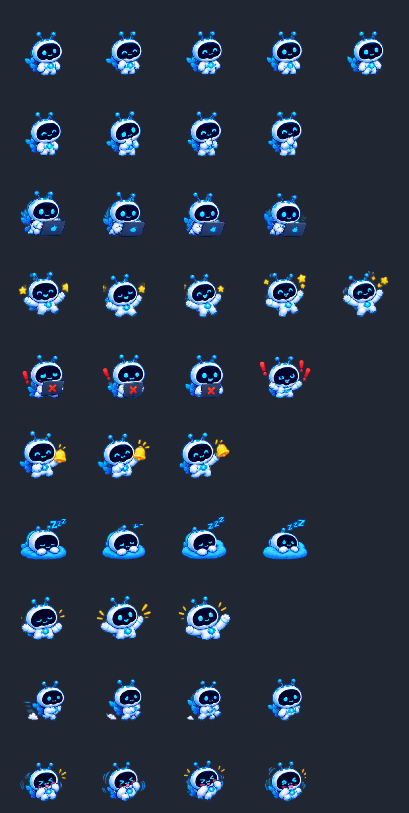

# Pet Studio

Một trang web nhỏ (không build, không thư viện) để chơi thử pet pack của dsh-go
ngoài app: xem đủ trạng thái, chọc/cù/nhấc pet, đổi cỡ, bật/tắt bong bóng.



## Chạy

Trang cần `http://` (fetch pack.json và ảnh), không mở bằng `file://`:

```sh
cd dsh-go-pets
python3 -m http.server 8099
# mở http://127.0.0.1:8099/pet-studio/
```

Chọn pack ở góc phải: **may** (đám mây pixel) hoặc **dsh-bot** (robot).

## Có gì

- **Trạng thái**: idle, thinking, working, attention (done), error, notification
  (chờ bạn), sleeping, waking, roam.
- **Tương tác**: chạm nửa trái/phải để poke, chạm 3 lần trong 1,1 s để cù, kéo
  để nhấc (reaction `drag`), đứng yên 60 s thì pet ngủ.
- **Cỡ**: 22 / 30 / 40 / 64 dp — đúng cách app chọn kích thước theo
  `contentBox.h`.
- **Im lặng**: không hiện bong bóng, pet vẫn diễn hoạt ảnh.
- **Tự diễn**: tự chạy qua các trạng thái để xem nhanh cả bộ.

## Cách hoạt động

`pet-engine.js` là bộ máy trạng thái thuần (không DOM): ưu tiên one-shot
(attention/error), notification giữ tới khi xoá, idle lâu thì ngủ, reaction
tạm thời. `pet-studio.js` chỉ lo canvas + sự kiện. Nhờ vậy engine chạy được
trong Node để test:

```sh
node --input-type=module -e "import('./pet-studio/pet-engine.js').then(m => console.log(Object.keys(m)))"
```

## Thêm pack

1. Bỏ pack vào `app/assets/pets/<id>/` (pack.json + các PNG).
2. Thêm một dòng vào `PACKS` trong `pet-studio.js`:

```js
const PACKS = { may: '...', 'dsh-bot': '...', '<id>': '../app/assets/pets/<id>/pack.json' };
```

## Giới hạn

- Đây là trang xem/chơi thử, không phải app dsh-go: không đọc trạng thái agent
  thật, không có overlay ngoài app, không import zip (pack phải nằm trong repo).
- Chưa chạy thử trên Safari cũ; cần trình duyệt hỗ trợ ES module + canvas.
